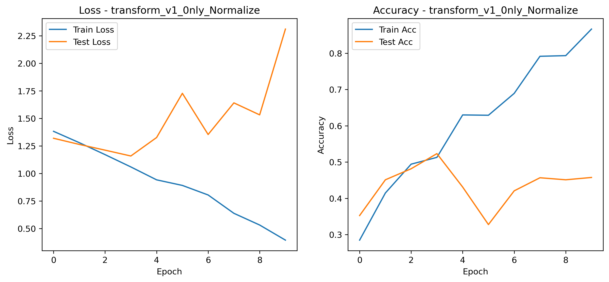
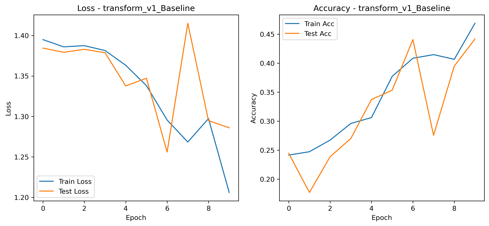
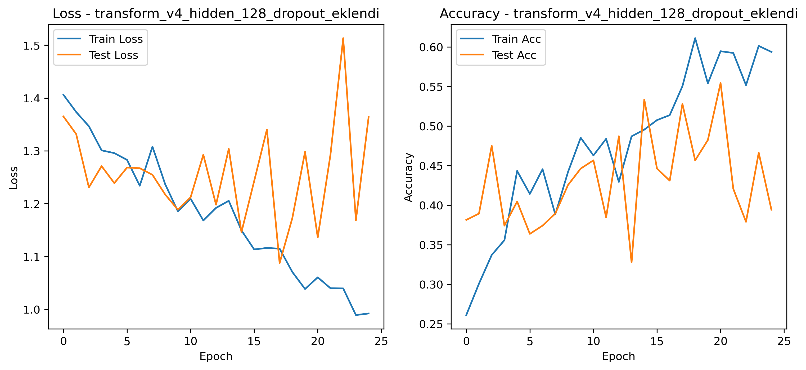
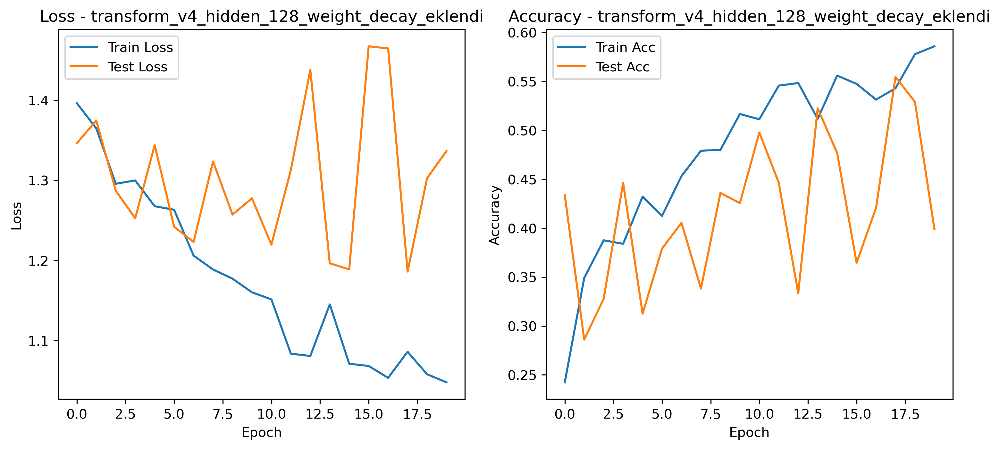

# 🍰 Dessert101: Convolutional Neural Networks (CNN) ile Yemek Görseli Sınıflandırma ve Hiperparametre Optimizasyonu

Bu proje, 4 farklı tatlı sınıfını (baklava, cannoli, cup_cakes, donuts) içeren Desert101 veri seti kullanılarak geliştirilmiş PyTorch tabanlı bir Derin Öğrenme (Deep Learning) çalışmasıdır. 

> ⚠️ **Akademik Uyarı ve Projenin Kapsamı (Disclaimer):**  
> Bu çalışmada, model eğitimi görece oldukça sınırlı bir veri seti (~400 görsel) ve bilerek tasarlanmış basit bir Özel Evrişimli Sinir Ağı (2 Bloklu Custom CNN) üzerinden gerçekleştirilmiştir. Eğitim sürecinde doğruluğun (Accuracy) %55-%60 bandında kalması, veri miktarının ve model kapasitesinin doğal bir sınırıdır. **Eğer amaç sadece %90+ doğruluk elde etmek olsaydı, devasa veri setleriyle önceden eğitilmiş (Pretrained) ResNet veya EfficientNet gibi modeller kullanılarak "Transfer Learning" (Transfer Öğrenme) tekniği ile bu hedefe kolayca ulaşılabilirdi.** Ancak bu projenin *asıl amacı*; sıfırdan oluşturulmuş bir mimari üzerinde hiperparametrelerin (Learning Rate, Dropout, L2 Regularization, Data Augmentation vb.) davranışlarını bilimsel olarak gözlemlemek, Aşırı Öğrenme (Overfitting) ile Eksik Öğrenme (Underfitting) arasındaki dengeyi anlamak ve **elimizdeki mevcut kısıtlı mimari/veri ile çıkarılabilecek en optimum (maksimum) performansı matematiksel bir yaklaşımla elde etmektir.**

## 🧠 Model Mimarisi (DessertClassifier)

Model, görsellerdeki karmaşık uzamsal özellikleri (spatial features) çıkarabilmek için iki evrişim bloğundan (Convolutional Block) ve bir sınıflandırıcıdan (Fully Connected) oluşturulmuştur:

*   **Evrişim Bloğu 1:** 2 adet `nn.Conv2d` (Kernel: 3, Stride: 1, Padding: 1) + `nn.ReLU` aktivasyonu + `nn.MaxPool2d` (Kernel: 2, Stride: 2)
*   **Evrişim Bloğu 2:** 2 adet `nn.Conv2d` (Kernel: 3, Stride: 1, Padding: 1) + `nn.ReLU` aktivasyonu + `nn.MaxPool2d` (Kernel: 2, Stride: 2)
*   **Sınıflandırıcı Katman:** `nn.Flatten()` + `nn.Dropout(p=0.4)` + `nn.Linear` (Çıktı Sınıfı: 4)
*   **Optimizasyon & Kayıp:** Adam Optimizer, CrossEntropyLoss

---

## 🔬 Hiperparametre Optimizasyon Süreci ve Bilimsel Çıktılar

Modelin eğitim sürecinde 5 farklı deney tasarımı uygulanmış ve elde edilen metrikler `results/metrics/` ile `results/plots/` klasörlerine loglanmıştır.

### 1. Aşırı Öğrenme Problemi (The Overfitting Trap) - Baseline Testi

İlk denemede modele hiçbir veri artırma tekniği uygulanmamış, sadece basit bir `Resize` ve veri setine özel hesaplanan `Normalize` işlemleri ile eğitim başlatılmıştır.

*   **Hiperparametreler:** Hidden Units: 32, LR: 0.001, Train Transforms: *Sadece Normalize*
*   **Analiz:** Model, eğitim (train) verisini ezberleyerek doğruluğunu (Accuracy) **%86.6** seviyelerine çıkarmış; ancak daha önce görmediği test verisinde **%52.3**'te tıkanmıştır. Test Loss grafiği 4. epoch'tan sonra ivmelenerek şiddetli bir overfitting (ezberleme) durumunu doğrulamıştır.



### 2. Veri Artırma ve Eksik Öğrenme (Data Augmentation & Underfitting)

Modeli ezberlemekten kurtarmak ve farklı açılardan genelleme yapmasını sağlamak için eğitim setine `RandomHorizontalFlip` ve `TrivialAugmentWide` gibi agresif veri bozma işlemleri eklenmiştir. *(Test setinin transformları temiz tutulmuştur).*

*   **Analiz:** Overfitting tamamen durmuş, train ve test kayıpları (loss) senkronize ilerlemeye başlamıştır. Ancak modelin kapasitesi (Hidden Units: 32) bu karmaşık (bozulmuş) veriyi öğrenmeye yetmemiş ve Accuracy **%45** seviyelerinde takılarak **Underfitting** (eksik öğrenme) eğilimi göstermiştir. Veriyi daha da bozmak (`ColorJitter` eklemek) sonucu %34'lere kadar düşürmüştür.



### 3. Model Kapasitesinin Artırılması ve Dropout

Underfitting problemini çözmek için modelin öğrenme kapasitesi 4 katına çıkarılmış (`hidden_units: 128`), ayrıca artan kapasitenin tekrar ezberlemeye yol açmaması için FC katmanından önce nöronların %40'ını kapatan `Dropout(p=0.4)` eklenmiştir. Daha stabil bir öğrenme için Learning Rate (LR) yarı yarıya (0.0005) düşürülmüştür.

*   **Analiz:** Kapasite artışı modelin öğrenme barajını kırmış ve test doğruluğunu **%55.4** seviyesine (en yüksek seviye), test kaybını ise **1.08** seviyesine taşımıştır.



### 4. İstikrarın Sağlanması: L2 Regularization (Weight Decay)

Kapasitesi artan modelin 18. epoch'tan sonra yaşadığı küçük çaplı test kaybı (test_loss) dalgalanmalarını sönümlemek amacıyla Adam optimizasyonuna `weight_decay=1e-4` eklenmiştir.

*   **Analiz:** Elde edilen en kararlı modeldir. Eğitim süreci boyunca modelin ezberleme hevesi tamamen törpülenmiş, eğitim doğruluğu ağır adımlarla %58.5'te sonlanırken test doğruluğu maksimum potansiyeli olan **%55.4**'e stabil bir şekilde oturmuştur.



---

## 📊 Karşılaştırmalı Deney Özeti

| Deney Adı | Kapasite | LR | Optimizer Ekstralar | Veri Artırma | Max Test Acc. |
| :--- | :--- | :--- | :--- | :--- | :--- |
| **Sadece Normalize** | 32 | 0.001 | Yok | Yok | %52.3 |
| **Baseline (Augmentation)** | 32 | 0.001 | Yok | HFlip + TrivialAug | %45.5 |
| **Aşırı Augmentation** | 32 | 0.001 | Yok | HFlip + VFlip + ColorJ + TrivialAug | %42.5 |
| **Kapasite + Dropout** | **128** | 0.0005 | **Dropout(p=0.4)** | HFlip + TrivialAug | **%55.4** |
| **Weight Decay (Final)** | 128 | 0.0005 | **Weight_Decay(1e-4)** | HFlip + TrivialAug | **%55.4** |

---

## 🚀 Projeyi Kendi Bilgisayarınızda Çalıştırma

Bu projeyi klonlayıp kendi parametrelerinizle test etmek isterseniz:

```bash
# Repoyu Klonlayın
git clone [https://github.com/Yusuf5825/Desert101-Hyperparameter-Tuning-CNN.git](https://github.com/Yusuf5825/Desert101-Hyperparameter-Tuning-CNN.git)
cd Desert101-Hyperparameter-Tuning-CNN

# Gerekli Kütüphaneleri Kurun (Örnek)
pip install torch torchvision matplotlib
